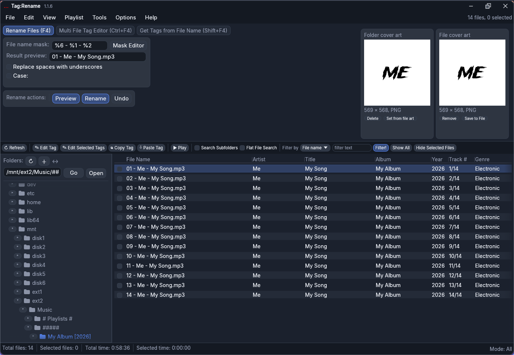
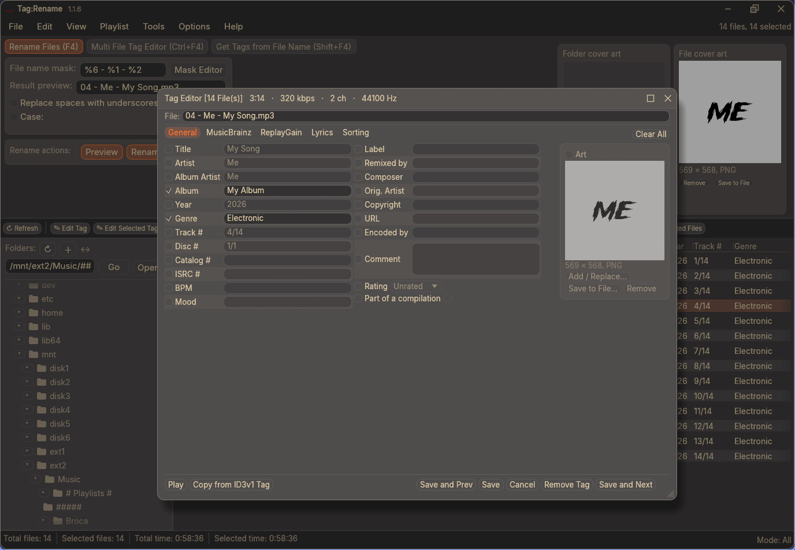
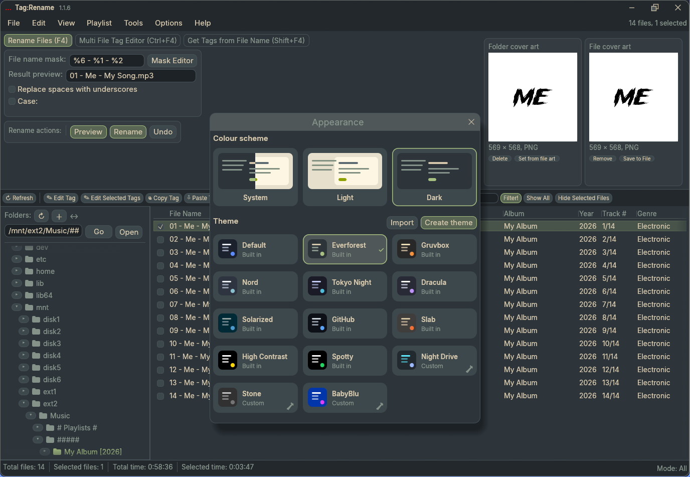

# Tag:Rename

A fast, modern dark/light tag editor and file renamer for music libraries, built in Rust with `egui/eframe`.



## Features

- **Tag editing** for common audio formats, including multi-file editing.
- **File and folder renaming** using masks, with retained mask choices.
- **MusicBrainz / ReplayGain / Lyrics / Sorting** tabs in the Tag Editor.
- **Cover art management**: add/replace, save to file, remove embedded art; folder cover art supports copy from file art and detects `folder.*` / `cover.*`.
- **Library browsing**: folder tree, flat file search, search subfolders, expand/collapse all folders.
- **Themes**: built-in light/dark themes, custom theme import/export, and live theme editing.
- **Export tags** to CSV/TEXT/HTML/XML.
- **Native OS integration**: file/folder pickers and OS file-manager flows where supported.
- **Linux and Windows packages**.

## Screenshots

| Homescreen | Tag Editor | Themes |
| --- | --- | --- |
|  |  |  |

## Install

### Linux

Download the latest Linux tarball from [Releases](https://github.com/brocass/tagrename/releases), then:

```bash
tar -xzf tagrename-*-linux-x86_64.tar.gz
cd tagrename-*-linux-x86_64
./install.sh
```

Run `./install.sh --uninstall` to remove it. User settings are kept in `~/.config/tagrename`.

On Arch-based systems, you can also install the packaged release artifact with:

```bash
sudo pacman -U tagrename-<version>-1-x86_64.pkg.tar.zst
```

### Windows

Download from [Releases](https://github.com/brocass/tagrename/releases):

- **Installer**: `Tag-Rename-<version>-setup.exe` (Start menu/desktop shortcut, file associations).
- **Portable ZIP**: `Tag-Rename-<version>-windows-x64.zip` (run `Tag-Rename.exe` directly).

Settings are stored in `%APPDATA%\Tag-Rename`.

## Build from source

### Linux

```bash
source ./setup-toolchain.sh
cargo build --release
./package.sh
```

### Windows

Windows packaging is built with the included Windows scripts/installer (`package-windows.bat`, `rebuild-all.ps1`, `tagrename-installer.iss`) in a Windows environment with the required Rust/MinGW/Inno Setup tools.

## Notes

- Use **View > Appearance** to select System/Light/Dark, import themes, or create custom themes.
- Custom themes are stored in `~/.config/tagrename/themes.json` on Linux.
- Tag:Rename is a desktop GUI application and requires a desktop session.

## Repository layout

- `src/` — Rust application source
- `assets/` — icons and desktop assets
- `package/` — packaged README/install helpers
- `docs/screenshots/` — README screenshots
- `tagrename-installer.iss` — Windows Inno Setup installer script
